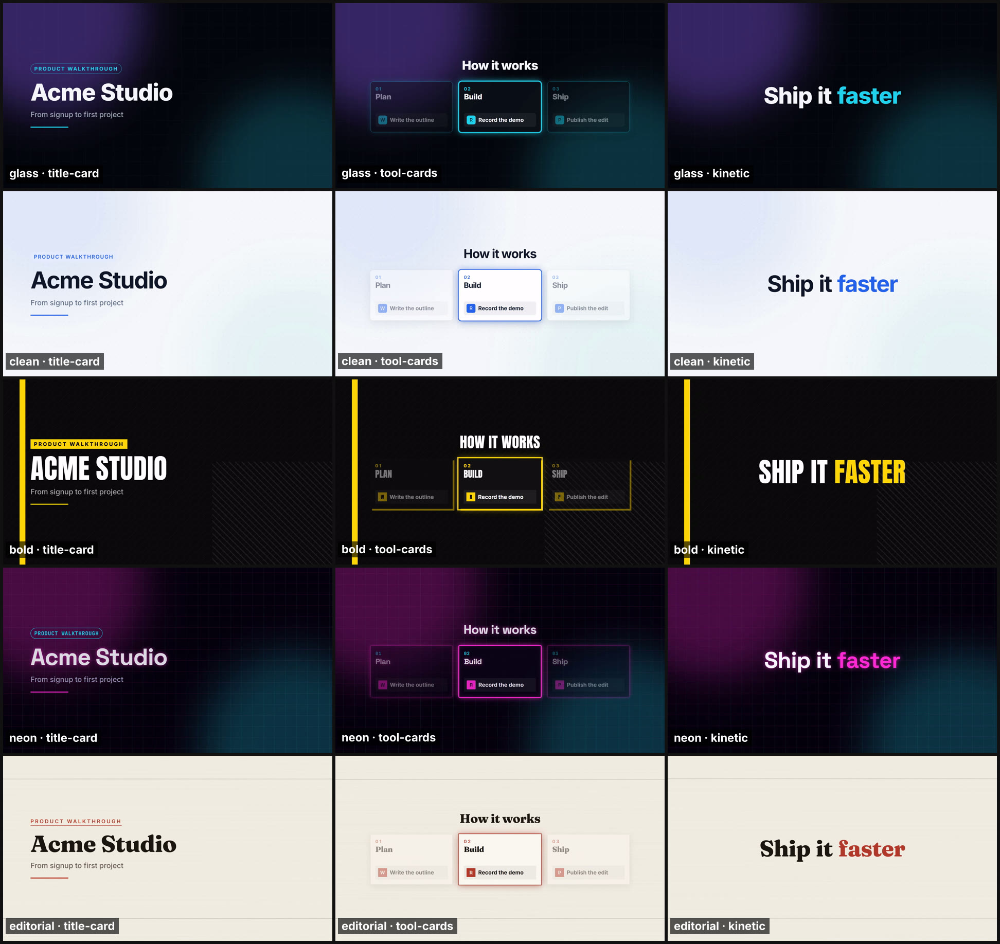

# video-prod

**A free, local YouTube editor that you drive by talking to [Claude Code](https://claude.com/claude-code).**

Record a screen demo with your face cam (or a VTuber avatar), then tell Claude "edit this". It:

- transcribes you on your own GPU;
- trims dead air and flubbed takes, but keeps your intro and sign-off;
- frames screen and camera, with auto-zooms where you clicked;
- adds animated titles, callouts and word-by-word captions in a theme you pick;
- mixes in music that ducks under your voice;
- exports a YouTube-ready 1080p video with chapters, title ideas, a description and tags.

There are no subscriptions and nothing is uploaded: it all runs on your PC. It shows you the cut list and a preview before the final render.



## How it works

The editing judgment is Claude's. Free tools do the heavy lifting, packaged as a Claude Code **skill** ([`.claude/skills/youtube-edit`](.claude/skills/youtube-edit/SKILL.md)):

| Step | Tool |
|---|---|
| Record screen + camera in one file, log clicks | [OBS Studio](https://obsproject.com) + `record.py` (optional; any MP4 works) |
| Transcribe with word timings | [NVIDIA Parakeet TDT 0.6B](https://huggingface.co/nvidia/parakeet-tdt-0.6b-v2) via NeMo |
| Cut pauses, fillers and retakes | Claude reads the transcript; FFmpeg cuts on frame boundaries |
| Layout: camera / screen / screen + bubble, click zooms | FFmpeg |
| Motion graphics (titles, callouts, lower thirds, steps, highlights, end card) | [HyperFrames](https://github.com/heygen-com/hyperframes) (HTML + GSAP → video) |
| Captions with the spoken word highlighted | libass |
| Music ducking, SFX, -14 LUFS loudness, H.264 export | FFmpeg |
| Fact-checking names and URLs, website screenshots | Claude's web search + headless Chrome |
| QA | Claude looks at contact sheets of the render against a quality checklist |

## Requirements

- **Windows 10 or 11.** The editing steps are plain Python + FFmpeg, but the recording helpers use Windows APIs, and it's only tested on Windows.
- **Claude Code** ([install](https://docs.claude.com/en/docs/claude-code/overview)).
- **An NVIDIA GPU** is recommended (any recent card with 4 GB+ of VRAM). Without one, everything still works; transcription and encoding are slower.
- **FFmpeg full build** on PATH (`winget install Gyan.FFmpeg`). It needs libass, libvpx and the `perspective` and `sidechaincompress` filters.
- **Node.js 22+** (`winget install OpenJS.NodeJS.LTS`).
- **Python 3.12** (`winget install Python.Python.3.12`).
- **About 10 GB of disk** for PyTorch, NeMo and the speech model.
- **OBS Studio 30+**, only if you record with the included setup.

## Quick start

```powershell
git clone https://github.com/anaremore/video-prod
cd video-prod
powershell -ExecutionPolicy Bypass -File .\setup.ps1
copy brand\brand.example.json brand\brand.json    # then put in your name, colors and devices
```

`setup.ps1` builds a `.venv` with PyTorch (CUDA when it finds an NVIDIA GPU) and NeMo, installs HyperFrames with npm, and runs `.\vp doctor`. Doctor checks everything and fixes what it can itself: it copies fonts and GSAP into place, converts caption fonts and synthesizes starter sound effects.

Then open the folder in Claude Code and ask:

> Edit my recording D:\Recordings\2026-10-12 demo.mp4

Claude follows the skill: transcribe, propose cuts, look at the footage, plan layout and graphics, render a preview, QA it, then do the final render and write the publish kit. You can also run any step yourself: `.\vp <step> <slug>`. Run `.\vp` alone to list the steps; each step takes `--help`.

The first transcription downloads the Parakeet model (about 2.4 GB) from Hugging Face.

## Recording (optional)

Any recording works. For the best results, use the OBS setup in [`reference/recording.md`](.claude/skills/youtube-edit/reference/recording.md):

- **One OBS file holds both views:** a size-locked Chrome window on top and your camera below. Screen and camera can never drift, and the layout can change after recording.
- **Two audio tracks:** your mic, and Chrome's own sound.
- **`.\vp setup_obs` adds a profile and scenes** to your OBS without touching your existing ones, and backs up your scene collection first.
- **`.\vp record` logs clicks** while you record, for auto-zooms. Press **F9** after a flub and Claude removes that take.
- **Lock the window** with [FrameLock](https://github.com/anaremore/framelock), or any tool that pins a window's content to exactly 1920×1080.

Filmed your face on a phone? Use `new_video --cam phone.mp4`, which syncs it to the screen recording by audio.

## Make it yours

| What | Where |
|---|---|
| Name, tagline, default theme, brand colors, caption style, camera framing, OBS devices, loudness, cut style | `brand/brand.json`: your overrides of [`brand/brand.default.json`](brand/brand.default.json). Start from [`brand.example.json`](brand/brand.example.json). |
| A theme for a client or brand | `motion/themes/themes.local.json`: reuse a look with your palette and caption font. See [`templates.md`](.claude/skills/youtube-edit/reference/templates.md). |
| A brand-new look | `motion/themes/<name>.css` + `themes.json` |
| New graphic templates | `motion/templates/` + `templates.json` ([conventions](.claude/skills/youtube-edit/reference/templates.md)) |
| Music | Drop mood-named tracks into `assets/music/` ([free, YouTube-safe sources](assets/music/README.md)) |

`.\vp gallery` renders every template in every theme on a frame of your latest video, so you can compare them. Every template in each built-in theme: [glass](docs/themes/glass.jpg), [clean](docs/themes/clean.jpg), [bold](docs/themes/bold.jpg), [neon](docs/themes/neon.jpg), [editorial](docs/themes/editorial.jpg).

**Cut styles:** `gentle` (the default) only removes pauses over a second plus content Claude flags, which suits screen demos. `tight` gives vlog-style jump cuts. `none` makes only the cuts you ask for. Your first two and last two sentences are protected from content cuts, because intros and sign-offs are part of a channel's format.

## Privacy

Footage, transcripts and renders stay on your machine. The only network use is:

- installing packages;
- downloading the speech model once;
- looking up the websites and products you mention, for fact-checking and screenshots.

HyperFrames telemetry and update checks are switched off.

These are gitignored, so they never end up in a fork or pull request: `videos/`, `local/` (OBS state and backups), `brand/brand.json`, `motion/themes/themes.local.json`, `CLAUDE.local.md` (your machine notes for Claude), and every generated file.

## Credits

- **Inspiration:** Christian Peverelli's [*I Fully Automated My Video Editing Using Claude Code*](https://www.youtube.com/watch?v=HzXD4GVqXwM). This project rebuilds that workflow with free tools.
- **[NVIDIA Parakeet TDT 0.6B v2](https://huggingface.co/nvidia/parakeet-tdt-0.6b-v2)** (CC-BY-4.0), via [NeMo](https://github.com/NVIDIA/NeMo) (Apache-2.0).
- **[HyperFrames](https://github.com/heygen-com/hyperframes)** by HeyGen (Apache-2.0).
- **[GSAP](https://gsap.com)**, installed from npm under its own license.
- **[FFmpeg](https://ffmpeg.org)** (LGPL/GPL) and **[OBS Studio](https://obsproject.com)** (GPL-2.0), installed separately.
- **Fonts** from [Fontsource](https://fontsource.org) (SIL Open Font License): Inter, Anton, Fraunces, JetBrains Mono, Space Grotesk.

## License

[MIT](LICENSE) for this repository's code and templates. Third-party tools and models keep their own licenses.
